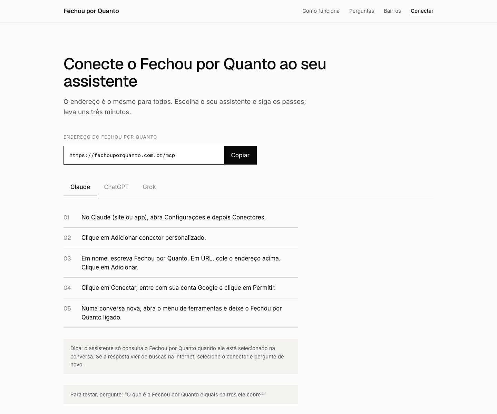

# Fechou por Quanto

Domínio: `fechouporquanto.com.br`. Os identificadores técnicos usam `m2-real` (repositório, pacotes, projetos Supabase/Vercel) e `m2_` (banco).

Base de preço real de apartamentos por **prédio e planta**, em 14 bairros de São Paulo. O preço vem do ITBI e a área privativa sai de calibração, sempre com selo. Os dados são consultados por agentes via MCP e conferidos num painel interno (`/painel`). A raiz do site (`/` e `/conectar`) é a página pública do produto. A especificação completa está em [`spec.md`](spec.md); os planos por épico, em [`plans/`](plans/).

## O produto

Site: **[fechouporquanto.com.br](https://fechouporquanto.com.br)** (o `www` redireciona; `m2-real.vercel.app` também responde).

A pessoa pergunta ao seu assistente de IA (Claude, ChatGPT ou Grok). Ele consulta o MCP do Fechou por Quanto e responde com as vendas reais registradas no ITBI, prédio a prédio. Cada m² vem com um selo que diz de onde veio a área privativa.




### Perguntas de exemplo (no assistente, com o Fechou por Quanto selecionado)
- "Por quanto foram vendidos os apartamentos da Rua João Ramalho, 586 nos últimos dois anos?" → `buscar_predio`, depois `vendas_predio`
- "Quanto valia a vaga de garagem nas últimas vendas da Rua João Ramalho, 586?" → `vendas_predio` (campo `valor_vagas`)
- "Quais foram as vendas mais recentes no prédio da Rua Iguatemi, 150?" → `vendas_predio`
- "O que é o Fechou por Quanto e quais bairros ele cobre?" → `sobre`

As medianas de bairro (`m2_bairro`) e os comparáveis (`comparaveis`) dependem do m² privativo, que ainda está sendo calibrado. Eles passam a responder quando houver fator de referência (regra 11.10).

### Chamando o MCP direto (scripts e testes)
O MCP é stateless e fala JSON-RPC por HTTP, em `POST /mcp`. Ele aceita duas credenciais:
- um token OAuth, que é o que os assistentes usam;
- uma chave de API criada no painel, em **Chaves de API**.

As seis ferramentas são `sobre`, `buscar_predio`, `ficha_predio`, `vendas_predio`, `m2_bairro` e `comparaveis` (seção 13.2 do spec).

```bash
curl -s https://fechouporquanto.com.br/mcp \
  -H "Authorization: Bearer $MCP_CHAVE" \
  -H "Content-Type: application/json" \
  -H "Accept: application/json, text/event-stream" \
  -d '{"jsonrpc":"2.0","id":1,"method":"tools/call","params":{"name":"buscar_predio","arguments":{"endereco":"Rua João Ramalho, 586"}}}'
```

A resposta (no campo `result.content[0].text`) vem em JSON:

```json
{
  "predios": [
    { "predio_id": "43cd91d0-47a4-4f91-b222-8bb1261dea36", "endereco": "RUA JOAO RAMALHO, 586", "bairro": "Perdizes",
      "ano_construcao": 1974, "total_unidades": 300, "similaridade": 1 }
  ],
  "fonte": "ITBI Prefeitura de SP + IPTU GeoSampa + calibração Fechou por Quanto",
  "atualizado_em": "2026-11-22T19:18:24.713+00:00",
  "dados_desatualizados": false,
  "motivo_desatualizacao": null
}
```

Depois, use o `predio_id` nas outras ferramentas:
- `vendas_predio`: `{"predio_id": "…", "meses": 24}`;
- `ficha_predio`: `{"predio_id": "…"}`;
- `comparaveis`: `{"predio_id": "…", "area_privativa": 95}`.

Sem credencial, a resposta é 401 com `WWW-Authenticate: Bearer resource_metadata="…"`. Por esse cabeçalho, o assistente descobre o OAuth sozinho. Acima do limite de uso da regra 11.22, a resposta é 429 com `Retry-After`. Os scripts `scripts/test-client.mjs` (MCP com chave) e `scripts/test-oauth.mjs` (fluxo OAuth e páginas públicas) testam um deploy de ponta a ponta.

## Requisitos
- Node.js ≥ 20 (testado com 22) e npm 10
- Docker (Supabase local)
- Supabase CLI ≥ 2.122
- `jq` (os guardrails em `.claude/hooks/` dependem dele)

## Setup local
```bash
npm install
cp .env.example .env.local      # preencha as chaves; nunca versione
supabase start -x vector,logflare,realtime,edge-runtime   # Postgres, Auth, REST e Storage em Docker
supabase db reset               # aplica supabase/migrations e o seed dos 14 bairros
```
A saída de `supabase start` mostra a `anon key` e a `service_role key` locais. Coloque-as em `.env.local`.

### Primeiro admin (seção 6.2)
1. Crie o usuário no Supabase Studio (Authentication → Add user).
2. Rode `supabase/seed/primeiro_admin.sql` com o e-mail desse usuário. O painel fica em `/painel`.

## Comandos (raiz)
| Comando | O que faz |
|---|---|
| `npm run typecheck` | `tsc --noEmit` em todos os workspaces |
| `npm test` | Vitest (regras da seção 11, parsers, coleta) |
| `npm run build` | build do Next.js |
| `npm run db:test` | testes pgTAP de RLS e funções (`supabase test db`) |
| `npm run ingestao -- <rotina> [args]` | roda uma rotina do pipeline |

Rotinas (seção 4.4): `itbi` (`ingestao-itbi`), `iptu` (`ingestao-iptu`), `anuncios` (`coleta-anuncios`), `leiloes` (`coleta-leiloes`) e `calibracao`. Exemplo: `npm run ingestao -- itbi 2025`.

## Carga anual do IPTU (manual, 1× por ano)
O GeoSampa bloqueia download por script (desafio anti-robô), então a carga do IPTU é manual. Ela é anual (seção 4.4, em fevereiro):
1. No navegador: GeoSampa → Download de Arquivos → 12_Cadastro → IPTU_INTER → XLS_CSV → `IPTU_<ano>`. Salve na raiz do repositório (o `.zip` fica fora do git).
2. `npm run ingestao -- iptu <ano> --arquivo IPTU_<ano>.zip`. O comando guarda o bruto em `m2_brutos/iptu/<ano>.zip` e carrega; leva ~1 min.
3. Sem `--arquivo`, a rotina lê o bruto já guardado no Storage. Com mais de 400 dias sem carga, a avaliação de saúde marca o IPTU como atrasado.

O Storage precisa aceitar arquivos de até 500 MiB (local: `supabase/config.toml`; remoto: configuração do projeto).

## Migrations
- Ficam em `supabase/migrations/`, com prefixo de data. Uma migration aplicada nunca é editada: mudança vira migration nova.
- Depois de cada migration: `npm run db:advisors` (security e performance; falha com qualquer `warn`), `npm run db:schema` (regenera o `schema.sql`) e `npm run db:types` (regenera `packages/db/src/types.ts`).
- Toda tabela `m2_*` nova repete o padrão de grants da migration `20261121120200` (só `select` para anon/authenticated); o teste `supabase/tests/010_estrutura` confere.
- Todo objeto do banco leva o prefixo `m2_`.

## Automação (GitHub Actions)
Os workflows ficam em `.github/workflows/` e rodam contra o banco na nuvem: o projeto Supabase **BANCO DE TESTE**, compartilhado com outros apps da DabLab, em que todos os objetos do Fechou por Quanto levam o prefixo `m2_`.

| Workflow | Quando (São Paulo) | O que faz |
|---|---|---|
| `ingestao-itbi` | dia 8, 06:10, e manual | planilhas do ITBI de 2021 em diante (só reprocessa as que mudaram) + calibração |
| `ingestao-iptu` | só manual (com o ano) | IPTU guardado no R2 + calibração |
| `coleta-anuncios` | segunda, 05:40, e manual | anúncios (teto de 50 créditos do Firecrawl) + calibração |
| `coleta-leiloes` | quarta, 05:40, e manual | editais de leilão (teto de 50 créditos) + calibração |
| `calibracao` | manual | calibração |
| `vigia` | todo dia, 07:00, e manual | saúde das cargas e sonda de busca; falha (e manda e-mail) se houver problema |
| `ci` | push no `main` e PR | typecheck, testes, build e pgTAP |

A `main` é protegida: mudanças entram só por PR, com os checks `verificacao` e `banco` verdes, e não aceita force push nem exclusão.

O botão "Executar agora" do painel (tela Execuções) dispara esses workflows pela API do GitHub (`GITHUB_TOKEN_DISPATCH`, só no servidor).

**Configuração do repositório** (Settings → Secrets and variables → Actions):
- Secrets: `SUPABASE_SERVICE_ROLE_KEY`, `FIRECRAWL_API_KEY`, `ANTHROPIC_API_KEY`, `R2_ACCOUNT_ID`, `R2_ACCESS_KEY_ID`, `R2_SECRET_ACCESS_KEY`.
- Variáveis: `NEXT_PUBLIC_SUPABASE_URL`, `R2_BUCKET`, `FIRECRAWL_MAX_CREDITOS_EXECUCAO`, `CLAUDE_MAX_DOCUMENTOS_EXECUCAO`, `LEILAO_MAX_ALVOS_EXECUCAO`, `LEILAO_DOMINIOS` e, se quiser, `ITBI_PAGINA_URL` e `IPTU_ARQUIVO_URL`.

**Token do "Executar agora":** fine-grained token do GitHub só para este repositório, com a permissão *Actions: Read and write*. Vai em `GITHUB_TOKEN_DISPATCH`, junto com `GITHUB_REPO=asiqueira1973/m2-real`, no ambiente do painel.

**Arquivos brutos no Cloudflare R2:** o Storage do plano grátis do Supabase aceita até 50 MB por arquivo, e o IPTU anual é bem maior. Por isso, no Actions os brutos vão para o bucket `m2-brutos` do R2 (mesma conta do Assina), com `BRUTOS_ARMAZEM=r2`. No ambiente local continuam no Storage do Supabase local. Secrets: `R2_ACCOUNT_ID`, `R2_ACCESS_KEY_ID`, `R2_SECRET_ACCESS_KEY`; variável: `R2_BUCKET`.

**IPTU anual na nuvem:** baixe o `IPTU_<ano>.zip` do GeoSampa e envie para `iptu/<ano>.zip` no bucket `m2-brutos` (painel da Cloudflare → R2 → m2-brutos → Upload). Depois rode o workflow `ingestao-iptu` informando o ano.

## MCP e OAuth

Endereço: `https://fechouporquanto.com.br/mcp`. No Claude, basta adicionar um conector personalizado com essa URL: ele descobre o OAuth (401 com `resource_metadata`), registra o cliente, abre "Entrar com Google" e o consentimento. Scripts podem usar uma chave de API criada no painel (`Authorization: Bearer <chave>`). Limites por conta OAuth: regras 11.21 e 11.22 em `packages/ingestao/src/config/regras.ts`.

Variáveis (Vercel e `.env.local`): `NEXT_PUBLIC_SITE_URL`, `GOOGLE_CLIENT_ID`, `GOOGLE_CLIENT_SECRET`, `SESSION_SECRET` (`openssl rand -base64 32`).

### Google Cloud (login do cliente)
Escopos só `openid email` (não sensíveis, sem verificação do Google). Projeto "Fechou por quanto" na conta da DabLab.
1. **Google Auth Platform → Branding:** nome `Fechou por quanto`; página inicial `https://fechouporquanto.com.br`; privacidade `https://fechouporquanto.com.br/privacidade`; termos `https://fechouporquanto.com.br/termos`; domínio autorizado `fechouporquanto.com.br`; sem logo.
2. **Data Access:** só `openid` e `.../auth/userinfo.email`.
3. **Audience:** External → **Publish app** (em produção).
4. **Clients → Create client:** Web application, `Fechou por Quanto web`. Origens: `http://localhost:3010`, `https://fechouporquanto.com.br`, `https://m2-real.vercel.app`. Redirect URIs: as mesmas origens com `/api/auth/google/callback`.
5. ID e segredo em `GOOGLE_CLIENT_ID` e `GOOGLE_CLIENT_SECRET`.

Testes contra um deploy: `MCP_URL=… MCP_CHAVE=… node scripts/test-client.mjs` (chave do painel) e `SITE_URL=… node scripts/test-oauth.mjs` (descoberta, registro, consentimento sem sessão e token inválido).

## Licença
[MIT](LICENSE) — DabLab — Alexandre da Silva de Siqueira LTDA - ME.

## Estrutura
Ver seção 18.3 do spec e o `CLAUDE.md`.
